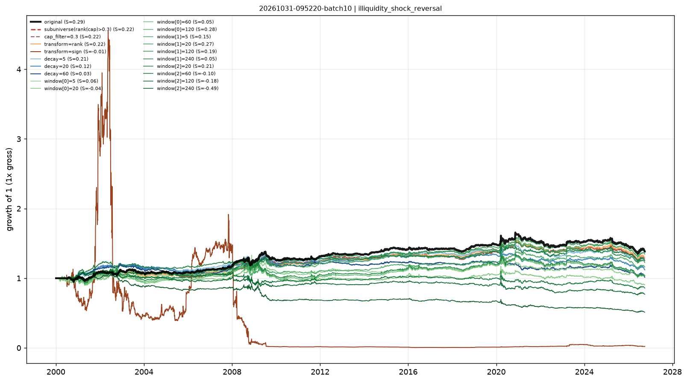

# Stability checks — illiquidity_shock_reversal

- run: `20261031-095220-batch10`
- expression: `(rank((ts_mean(amount, 240) / ts_mean(amount, 60))) * (1 - rank(abs(ts_returns(close, 5, 0)))))`
- baseline: decay=0, transform=none, cap=None

Each variant keeps the signal and changes one implementation knob. `pnl_corr_with_original` is the daily pnl correlation with the baseline.

The sub-universe variant removes the smallest 30% by cap rank.

| variant | group | sharpe | ann_return | turnover | max_drawdown | rank_ic | pnl_corr_with_original |
|---|---|---|---|---|---|---|---|
| original | original | 0.2905 | 0.01222 | 72.82 | -0.186 | 0.002812 | 1 |
| subuniverse(rank(cap)>0.3) | subuniverse | 0.2164 | 0.00858 | 72.52 | -0.1974 | - | 0.926 |
| cap_filter=0.3 | cap | 0.2164 | 0.00858 | 72.52 | -0.1974 | - | 0.926 |
| transform=rank | transform | 0.2186 | 0.00954 | 64.96 | -0.1968 | - | 0.9819 |
| transform=sign | transform | -0.009702 | -0.1356 | 66.19 | -0.999 | - | 0.2456 |
| decay=5 | decay | 0.2073 | 0.008321 | 31.85 | -0.1875 | - | 0.915 |
| decay=20 | decay | 0.1181 | 0.004221 | 11.14 | -0.2134 | - | 0.8121 |
| decay=60 | decay | 0.03298 | 4.92e-04 | 4.892 | -0.2128 | - | 0.7481 |
| window[0]=5 | window | 0.05503 | 0.001505 | 84.84 | -0.2302 | - | 0.6555 |
| window[0]=20 | window | -0.03911 | -0.003789 | 75.36 | -0.262 | - | 0.6395 |
| window[0]=60 | window | 0.0481 | 9.69e-04 | 103.2 | -0.2631 | - | 0.7726 |
| window[0]=120 | window | 0.2831 | 0.0122 | 73.31 | -0.1526 | - | 0.9322 |
| window[1]=5 | window | 0.1499 | 0.005615 | 76.31 | -0.1915 | - | 0.9108 |
| window[1]=20 | window | 0.2709 | 0.01116 | 72.75 | -0.1935 | - | 0.953 |
| window[1]=120 | window | 0.1894 | 0.007594 | 72.89 | -0.219 | - | 0.9554 |
| window[1]=240 | window | 0.05317 | 0.001325 | 101.7 | -0.2658 | - | 0.7814 |
| window[2]=20 | window | 0.2135 | 0.008575 | 42.38 | -0.1948 | - | 0.7006 |
| window[2]=60 | window | -0.1039 | -0.005757 | 26.43 | -0.2576 | - | 0.6683 |
| window[2]=120 | window | -0.1804 | -0.009795 | 19.76 | -0.3206 | - | 0.6484 |
| window[2]=240 | window | -0.4888 | -0.02481 | 14 | -0.5293 | - | 0.6114 |

