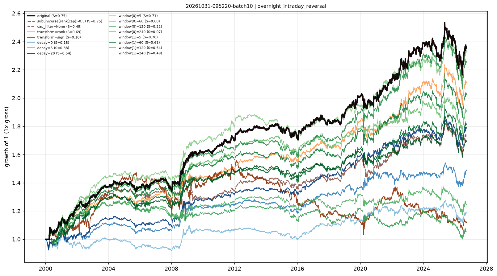

# Stability checks — overnight_intraday_reversal

- run: `20261031-095220-batch10`
- expression: `-rank((ts_sum(overnight_return, 20) / (abs(ts_sum(intraday_return, 20)) + 1e-06)))`
- baseline: decay=60, transform=none, cap=0.3

Each variant keeps the signal and changes one implementation knob. `pnl_corr_with_original` is the daily pnl correlation with the baseline.

Note: when the baseline already uses `cap_filter=0.3`, the sub-universe variant is identical by construction (both drop the smallest 30%).

| variant | group | sharpe | ann_return | turnover | max_drawdown | rank_ic | pnl_corr_with_original |
|---|---|---|---|---|---|---|---|
| original | original | 0.7498 | 0.03274 | 7.284 | -0.1462 | 6.31e-04 | 1 |
| subuniverse(rank(cap)>0.3) | subuniverse | 0.7498 | 0.03274 | 7.284 | -0.1462 | - | 1 |
| cap_filter=None | cap | 0.4888 | 0.02072 | 7.069 | -0.1338 | - | 0.8755 |
| transform=rank | transform | 0.6926 | 0.02846 | 7.328 | -0.1281 | - | 0.9293 |
| transform=sign | transform | 0.09885 | 0.004353 | 7.927 | -0.3401 | - | 0.3372 |
| decay=0 | decay | 0.1788 | 0.006478 | 46.86 | -0.1267 | - | 0.4928 |
| decay=5 | decay | 0.3807 | 0.01507 | 23.61 | -0.1106 | - | 0.5745 |
| decay=20 | decay | 0.5387 | 0.02207 | 12.87 | -0.115 | - | 0.7872 |
| window[0]=5 | window | 0.7058 | 0.03231 | 13.18 | -0.1247 | - | 0.9021 |
| window[0]=60 | window | 0.6006 | 0.02461 | 4.475 | -0.1308 | - | 0.8335 |
| window[0]=120 | window | 0.2247 | 0.008331 | 3.429 | -0.1516 | - | 0.6399 |
| window[0]=240 | window | 0.07199 | 0.00211 | 2.918 | -0.2204 | - | 0.5534 |
| window[1]=5 | window | 0.6999 | 0.03104 | 7.527 | -0.1651 | - | 0.9746 |
| window[1]=60 | window | 0.6125 | 0.02693 | 7.044 | -0.1438 | - | 0.9592 |
| window[1]=120 | window | 0.542 | 0.02264 | 6.847 | -0.1355 | - | 0.9122 |
| window[1]=240 | window | 0.4895 | 0.02003 | 6.68 | -0.1542 | - | 0.8951 |

