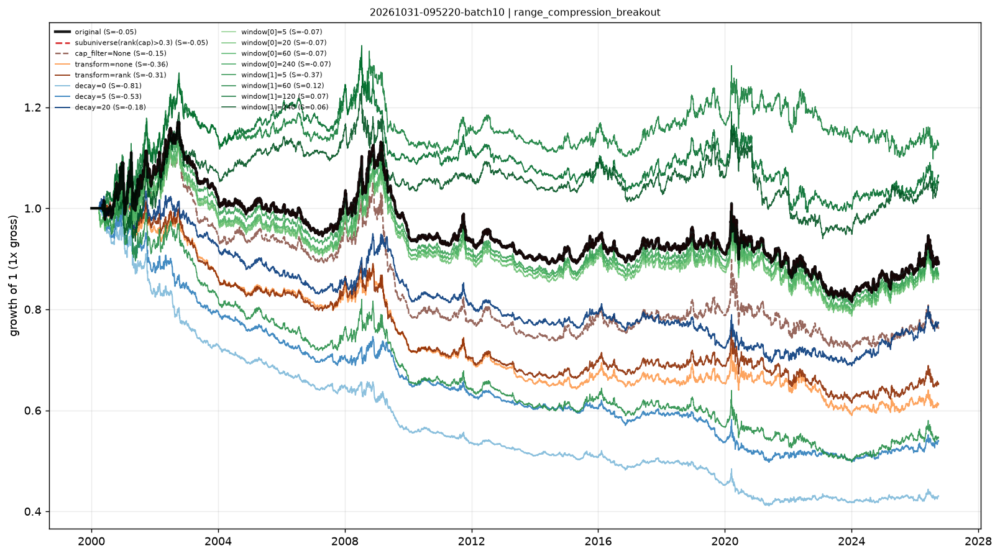

# Stability checks — range_compression_breakout

- run: `20261031-095220-batch10`
- expression: `((1 - rank((ts_mean(range, 120) / close))) * zscore(ts_mean(close_position, 20)))`
- baseline: decay=60, transform=sign, cap=0.3

Each variant keeps the signal and changes one implementation knob. `pnl_corr_with_original` is the daily pnl correlation with the baseline.

Note: when the baseline already uses `cap_filter=0.3`, the sub-universe variant is identical by construction (both drop the smallest 30%).

| variant | group | sharpe | ann_return | turnover | max_drawdown | rank_ic | pnl_corr_with_original |
|---|---|---|---|---|---|---|---|
| original | original | -0.0515 | -0.004269 | 7.373 | -0.304 | 0.004025 | 1 |
| subuniverse(rank(cap)>0.3) | subuniverse | -0.0515 | -0.004269 | 7.373 | -0.304 | - | 1 |
| cap_filter=None | cap | -0.1537 | -0.01003 | 7.245 | -0.3778 | - | 0.9515 |
| transform=none | transform | -0.3573 | -0.01824 | 6.055 | -0.4459 | - | 0.9236 |
| transform=rank | transform | -0.3126 | -0.01589 | 6.586 | -0.4221 | - | 0.9453 |
| decay=0 | decay | -0.8118 | -0.03111 | 27.47 | -0.5937 | - | 0.6868 |
| decay=5 | decay | -0.531 | -0.02287 | 17.28 | -0.5075 | - | 0.7368 |
| decay=20 | decay | -0.1849 | -0.009571 | 11.11 | -0.356 | - | 0.877 |
| window[0]=5 | window | -0.06837 | -0.005249 | 7.404 | -0.2989 | - | 0.9939 |
| window[0]=20 | window | -0.07414 | -0.005563 | 7.404 | -0.3004 | - | 0.9939 |
| window[0]=60 | window | -0.06944 | -0.005287 | 7.404 | -0.302 | - | 0.9952 |
| window[0]=240 | window | -0.06982 | -0.005138 | 7.32 | -0.3038 | - | 0.9905 |
| window[1]=5 | window | -0.3679 | -0.02242 | 15.13 | -0.5193 | - | 0.9383 |
| window[1]=60 | window | 0.1152 | 0.004524 | 3.614 | -0.1669 | - | 0.8698 |
| window[1]=120 | window | 0.07324 | 0.002391 | 2.272 | -0.2499 | - | 0.7276 |
| window[1]=240 | window | 0.06409 | 0.001912 | 1.489 | -0.2433 | - | 0.6383 |

