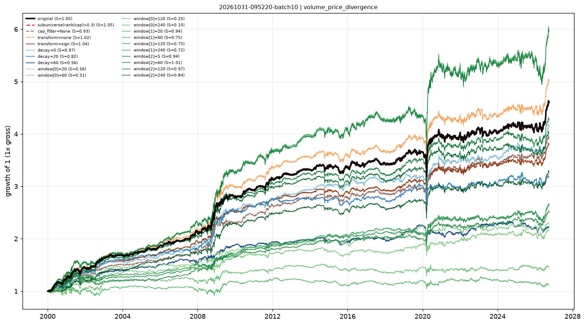

# Stability checks — volume_price_divergence

- run: `20261031-095220-batch10`
- expression: `-(rank(ts_returns(close, 5, 0)) - rank((ts_mean(volume, 5) / ts_mean(volume, 20))))`
- baseline: decay=5, transform=rank, cap=0.3

Each variant keeps the signal and changes one implementation knob. `pnl_corr_with_original` is the daily pnl correlation with the baseline.

Note: when the baseline already uses `cap_filter=0.3`, the sub-universe variant is identical by construction (both drop the smallest 30%).

| variant | group | sharpe | ann_return | turnover | max_drawdown | rank_ic | pnl_corr_with_original |
|---|---|---|---|---|---|---|---|
| original | original | 1.053 | 0.05885 | 41.42 | -0.1401 | 0.0113 | 1 |
| subuniverse(rank(cap)>0.3) | subuniverse | 1.053 | 0.05885 | 41.42 | -0.1401 | - | 1 |
| cap_filter=None | cap | 0.93 | 0.05255 | 40.65 | -0.1754 | - | 0.9521 |
| transform=none | transform | 1.019 | 0.06224 | 42.21 | -0.1542 | - | 0.9944 |
| transform=sign | transform | 1.042 | 0.05137 | 40.9 | -0.1257 | - | 0.9874 |
| decay=0 | decay | 0.9653 | 0.05486 | 63.06 | -0.1341 | - | 0.8811 |
| decay=20 | decay | 0.8214 | 0.04419 | 24.15 | -0.1409 | - | 0.7661 |
| decay=60 | decay | 0.5572 | 0.03041 | 15.17 | -0.138 | - | 0.5174 |
| window[0]=20 | window | 0.5633 | 0.03157 | 28.85 | -0.1496 | - | 0.6908 |
| window[0]=60 | window | 0.5084 | 0.02966 | 25.87 | -0.123 | - | 0.4702 |
| window[0]=120 | window | 0.2521 | 0.0141 | 24.97 | -0.1477 | - | 0.3715 |
| window[0]=240 | window | 0.09567 | 0.004074 | 24.18 | -0.1747 | - | 0.2759 |
| window[1]=20 | window | 0.9402 | 0.06942 | 46.44 | -0.182 | - | 0.9211 |
| window[1]=60 | window | 0.753 | 0.03736 | 32.28 | -0.1169 | - | 0.8133 |
| window[1]=120 | window | 0.7483 | 0.03716 | 31.44 | -0.1121 | - | 0.7916 |
| window[1]=240 | window | 0.716 | 0.03523 | 30.83 | -0.1079 | - | 0.7624 |
| window[2]=5 | window | 0.9366 | 0.06916 | 46.48 | -0.1815 | - | 0.921 |
| window[2]=60 | window | 1.008 | 0.05593 | 38.04 | -0.1336 | - | 0.9584 |
| window[2]=120 | window | 0.9672 | 0.05349 | 36.88 | -0.1307 | - | 0.9289 |
| window[2]=240 | window | 0.8376 | 0.04552 | 35.68 | -0.1342 | - | 0.8842 |

