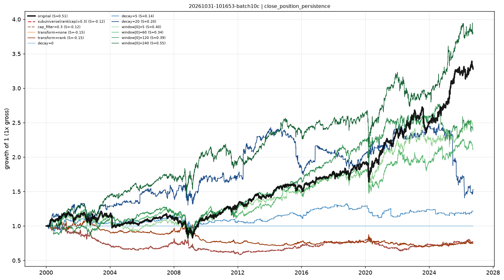

# Stability checks — close_position_persistence

- run: `20261031-101653-batch10c`
- expression: `rank(ts_mean(close_position, 20))`
- baseline: decay=60, transform=sign, cap=None

Each variant keeps the signal and changes one implementation knob. `pnl_corr_with_original` is the daily pnl correlation with the baseline.

The sub-universe variant removes the smallest 30% by cap rank.

| variant | group | sharpe | ann_return | turnover | max_drawdown | rank_ic | pnl_corr_with_original |
|---|---|---|---|---|---|---|---|
| original | original | 0.5112 | 0.0455 | 8.271 | -0.3201 | 1.59e-04 | 1 |
| subuniverse(rank(cap)>0.3) | subuniverse | -0.1174 | -0.009894 | 7.934 | -0.4197 | - | -0.1442 |
| cap_filter=0.3 | cap | -0.1174 | -0.009894 | 7.934 | -0.4197 | - | -0.1442 |
| transform=none | transform | -0.1499 | -0.01073 | 6.123 | -0.3874 | - | -0.3148 |
| transform=rank | transform | -0.1499 | -0.01073 | 6.123 | -0.3874 | - | -0.3148 |
| decay=0 | decay | - | 0 | 0 | 0 | - | - |
| decay=5 | decay | 0.1448 | 0.007347 | 24.2 | -0.1988 | - | 0.2274 |
| decay=20 | decay | 0.1991 | 0.01608 | 16.14 | -0.4339 | - | 0.3912 |
| window[0]=5 | window | 0.3955 | 0.03405 | 8.294 | -0.3252 | - | 0.8127 |
| window[0]=60 | window | 0.3367 | 0.0283 | 8.279 | -0.317 | - | 0.6544 |
| window[0]=120 | window | 0.3887 | 0.03313 | 8.232 | -0.3228 | - | 0.5857 |
| window[0]=240 | window | 0.5512 | 0.05114 | 8.195 | -0.2122 | - | 0.5209 |

