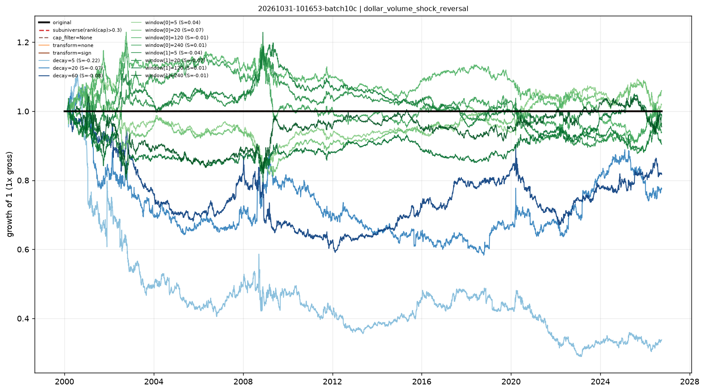

# Stability checks — dollar_volume_shock_reversal

- run: `20261031-101653-batch10c`
- expression: `-rank((ts_mean(amount, 60) / ts_mean(amount, 60)))`
- baseline: decay=0, transform=rank, cap=0.3

Each variant keeps the signal and changes one implementation knob. `pnl_corr_with_original` is the daily pnl correlation with the baseline.

Note: when the baseline already uses `cap_filter=0.3`, the sub-universe variant is identical by construction (both drop the smallest 30%).

| variant | group | sharpe | ann_return | turnover | max_drawdown | rank_ic | pnl_corr_with_original |
|---|---|---|---|---|---|---|---|
| original | original | - | 0 | 0 | 0 | - | - |
| subuniverse(rank(cap)>0.3) | subuniverse | - | 0 | 0 | 0 | - | - |
| cap_filter=None | cap | - | 0 | 0 | 0 | - | - |
| transform=none | transform | - | 0 | 0 | 0 | - | - |
| transform=sign | transform | - | 0 | 0 | 0 | - | - |
| decay=5 | decay | -0.2232 | -0.03984 | 66.99 | -0.7383 | - | - |
| decay=20 | decay | -0.07449 | -0.009418 | 19.85 | -0.456 | - | - |
| decay=60 | decay | -0.08018 | -0.007546 | 7.949 | -0.4108 | - | - |
| window[0]=5 | window | 0.03766 | 7.07e-04 | 40.36 | -0.2831 | - | - |
| window[0]=20 | window | 0.07489 | 0.002185 | 18.56 | -0.253 | - | - |
| window[0]=120 | window | -0.01284 | -0.001455 | 10.4 | -0.2591 | - | - |
| window[0]=240 | window | 0.01246 | -5.54e-04 | 7.43 | -0.2425 | - | - |
| window[1]=5 | window | -0.03766 | -0.002333 | 40.36 | -0.2795 | - | - |
| window[1]=20 | window | -0.07489 | -0.003746 | 18.56 | -0.282 | - | - |
| window[1]=120 | window | 0.01284 | -3.60e-04 | 10.4 | -0.2012 | - | - |
| window[1]=240 | window | -0.01246 | -0.001744 | 7.43 | -0.2194 | - | - |

