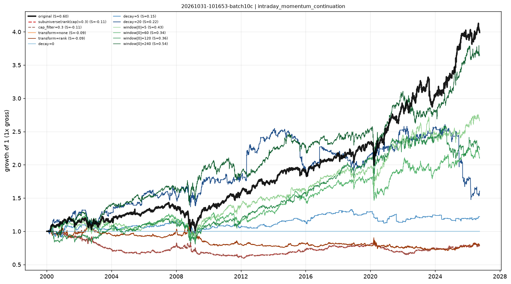

# Stability checks — intraday_momentum_continuation

- run: `20261031-101653-batch10c`
- expression: `rank(ts_sum(intraday_return, 20))`
- baseline: decay=60, transform=sign, cap=None

Each variant keeps the signal and changes one implementation knob. `pnl_corr_with_original` is the daily pnl correlation with the baseline.

The sub-universe variant removes the smallest 30% by cap rank.

| variant | group | sharpe | ann_return | turnover | max_drawdown | rank_ic | pnl_corr_with_original |
|---|---|---|---|---|---|---|---|
| original | original | 0.6007 | 0.05322 | 8.282 | -0.2981 | 2.79e-04 | 1 |
| subuniverse(rank(cap)>0.3) | subuniverse | -0.1082 | -0.009251 | 7.933 | -0.4096 | - | -0.1454 |
| cap_filter=0.3 | cap | -0.1082 | -0.009251 | 7.933 | -0.4096 | - | -0.1454 |
| transform=none | transform | -0.09058 | -0.008641 | 6.785 | -0.3642 | - | -0.2763 |
| transform=rank | transform | -0.09058 | -0.008641 | 6.785 | -0.3642 | - | -0.2763 |
| decay=0 | decay | - | 0 | 0 | 0 | - | - |
| decay=5 | decay | 0.1468 | 0.007484 | 24.28 | -0.1988 | - | 0.2308 |
| decay=20 | decay | 0.215 | 0.0179 | 16.19 | -0.4339 | - | 0.405 |
| window[0]=5 | window | 0.4277 | 0.03733 | 8.296 | -0.2727 | - | 0.8365 |
| window[0]=60 | window | 0.3352 | 0.02814 | 8.317 | -0.317 | - | 0.6142 |
| window[0]=120 | window | 0.3614 | 0.03046 | 8.277 | -0.3228 | - | 0.6005 |
| window[0]=240 | window | 0.536 | 0.04958 | 8.222 | -0.2122 | - | 0.5293 |

