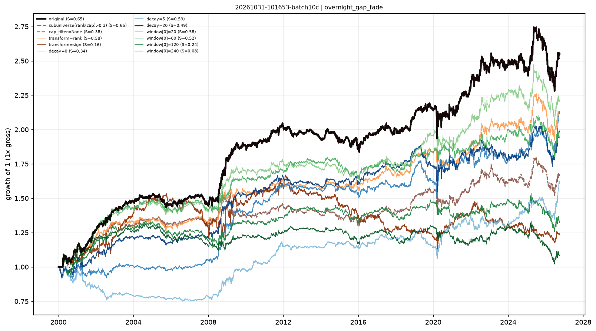

# Stability checks — overnight_gap_fade

- run: `20261031-101653-batch10c`
- expression: `-rank(ts_sum(overnight_return, 5))`
- baseline: decay=60, transform=none, cap=0.3

Each variant keeps the signal and changes one implementation knob. `pnl_corr_with_original` is the daily pnl correlation with the baseline.

Note: when the baseline already uses `cap_filter=0.3`, the sub-universe variant is identical by construction (both drop the smallest 30%).

| variant | group | sharpe | ann_return | turnover | max_drawdown | rank_ic | pnl_corr_with_original |
|---|---|---|---|---|---|---|---|
| original | original | 0.6517 | 0.03575 | 12.23 | -0.1704 | 0.001756 | 1 |
| subuniverse(rank(cap)>0.3) | subuniverse | 0.6517 | 0.03575 | 12.23 | -0.1704 | - | 1 |
| cap_filter=None | cap | 0.3768 | 0.01938 | 12.2 | -0.1618 | - | 0.9004 |
| transform=rank | transform | 0.5762 | 0.02863 | 12.21 | -0.1496 | - | 0.8909 |
| transform=sign | transform | 0.1562 | 0.008137 | 7.938 | -0.3262 | - | 0.3928 |
| decay=0 | decay | 0.3449 | 0.01828 | 66.47 | -0.2556 | - | 0.323 |
| decay=5 | decay | 0.5271 | 0.02868 | 43.91 | -0.1749 | - | 0.472 |
| decay=20 | decay | 0.4942 | 0.02609 | 22.81 | -0.1781 | - | 0.7742 |
| window[0]=20 | window | 0.5831 | 0.03022 | 6.504 | -0.1798 | - | 0.9173 |
| window[0]=60 | window | 0.5196 | 0.0252 | 3.623 | -0.1441 | - | 0.7108 |
| window[0]=120 | window | 0.2382 | 0.0106 | 2.342 | -0.1813 | - | 0.5578 |
| window[0]=240 | window | 0.08313 | 0.002902 | 1.615 | -0.2347 | - | 0.4918 |

