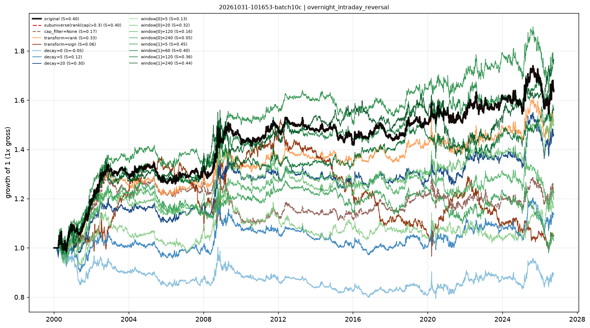

# Stability checks — overnight_intraday_reversal

- run: `20261031-101653-batch10c`
- expression: `-rank((ts_sum(overnight_return, 60) - ts_sum(intraday_return, 20)))`
- baseline: decay=60, transform=none, cap=0.3

Each variant keeps the signal and changes one implementation knob. `pnl_corr_with_original` is the daily pnl correlation with the baseline.

Note: when the baseline already uses `cap_filter=0.3`, the sub-universe variant is identical by construction (both drop the smallest 30%).

| variant | group | sharpe | ann_return | turnover | max_drawdown | rank_ic | pnl_corr_with_original |
|---|---|---|---|---|---|---|---|
| original | original | 0.3962 | 0.01872 | 4.501 | -0.1121 | -3.58e-04 | 1 |
| subuniverse(rank(cap)>0.3) | subuniverse | 0.3962 | 0.01872 | 4.501 | -0.1121 | - | 1 |
| cap_filter=None | cap | 0.1738 | 0.007701 | 4.277 | -0.1964 | - | 0.8987 |
| transform=rank | transform | 0.3299 | 0.01577 | 4.463 | -0.107 | - | 0.974 |
| transform=sign | transform | 0.06208 | 0.001921 | 7.951 | -0.365 | - | -0.002322 |
| decay=0 | decay | -0.05026 | -0.004156 | 25.1 | -0.2356 | - | 0.7455 |
| decay=5 | decay | 0.1184 | 0.00488 | 13.43 | -0.1778 | - | 0.785 |
| decay=20 | decay | 0.3028 | 0.01429 | 7.775 | -0.1212 | - | 0.9031 |
| window[0]=5 | window | 0.1256 | 0.005713 | 7.179 | -0.212 | - | 0.7071 |
| window[0]=20 | window | 0.3161 | 0.0153 | 6.614 | -0.138 | - | 0.8692 |
| window[0]=120 | window | 0.1599 | 0.006803 | 3.117 | -0.1655 | - | 0.8831 |
| window[0]=240 | window | 0.04704 | 0.001104 | 2.13 | -0.2326 | - | 0.7502 |
| window[1]=5 | window | 0.4459 | 0.02124 | 4.099 | -0.1417 | - | 0.8895 |
| window[1]=60 | window | 0.3972 | 0.01878 | 3.78 | -0.08083 | - | 0.7918 |
| window[1]=120 | window | 0.3585 | 0.01693 | 2.771 | -0.1173 | - | 0.4973 |
| window[1]=240 | window | 0.4351 | 0.02152 | 2.095 | -0.1573 | - | 0.2849 |

