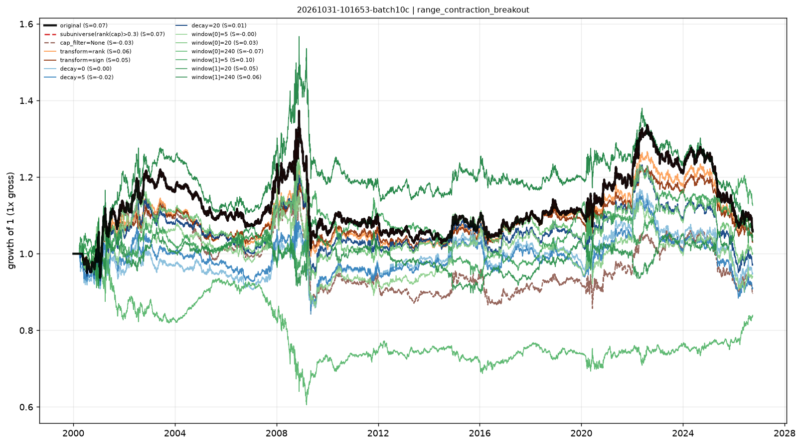

# Stability checks — range_contraction_breakout

- run: `20261031-101653-batch10c`
- expression: `-zscore((ts_mean(((high - low) / close), 60) / ts_mean(((high - low) / close), 120)))`
- baseline: decay=60, transform=none, cap=0.3

Each variant keeps the signal and changes one implementation knob. `pnl_corr_with_original` is the daily pnl correlation with the baseline.

Note: when the baseline already uses `cap_filter=0.3`, the sub-universe variant is identical by construction (both drop the smallest 30%).

| variant | group | sharpe | ann_return | turnover | max_drawdown | rank_ic | pnl_corr_with_original |
|---|---|---|---|---|---|---|---|
| original | original | 0.06519 | 0.002121 | 4.519 | -0.2615 | 0.002269 | 1 |
| subuniverse(rank(cap)>0.3) | subuniverse | 0.06519 | 0.002121 | 4.519 | -0.2615 | - | 1 |
| cap_filter=None | cap | -0.03243 | -0.004125 | 4.394 | -0.2786 | - | 0.9316 |
| transform=rank | transform | 0.05718 | 0.001629 | 4.587 | -0.1999 | - | 0.9807 |
| transform=sign | transform | 0.04706 | 0.001105 | 4.575 | -0.1628 | - | 0.9641 |
| decay=0 | decay | 9.79e-04 | -0.002009 | 15.99 | -0.2261 | - | 0.8519 |
| decay=5 | decay | -0.02337 | -0.003563 | 9.558 | -0.2356 | - | 0.8734 |
| decay=20 | decay | 0.01415 | -0.001124 | 6.038 | -0.242 | - | 0.933 |
| window[0]=5 | window | -9.05e-05 | -0.002344 | 8.489 | -0.2702 | - | 0.8085 |
| window[0]=20 | window | 0.03298 | -2.92e-05 | 5.624 | -0.2554 | - | 0.8856 |
| window[0]=120 | window | - | - | - | - | - | - |
| window[0]=240 | window | -0.06908 | -0.006524 | 2.605 | -0.4044 | - | -0.59 |
| window[1]=5 | window | 0.1039 | 0.004451 | 10.58 | -0.1973 | - | -0.4745 |
| window[1]=20 | window | 0.04982 | 0.001215 | 7.737 | -0.1826 | - | -0.5451 |
| window[1]=60 | window | - | - | - | - | - | - |
| window[1]=240 | window | 0.0571 | 0.001531 | 3.062 | -0.3354 | - | 0.8707 |

