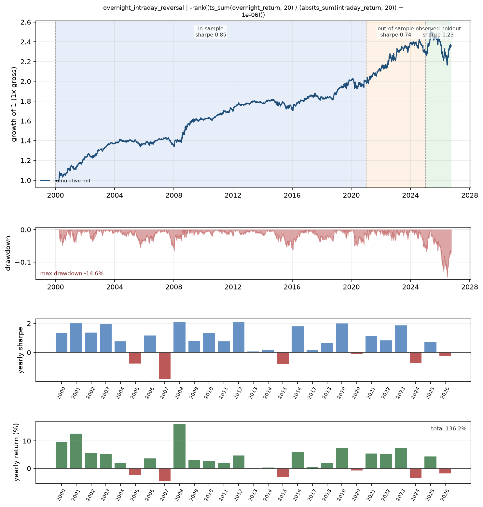
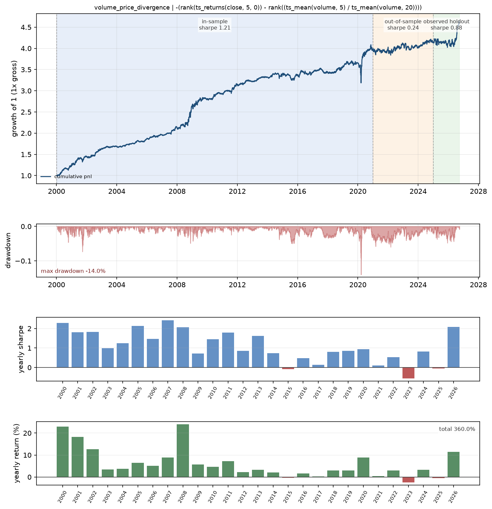
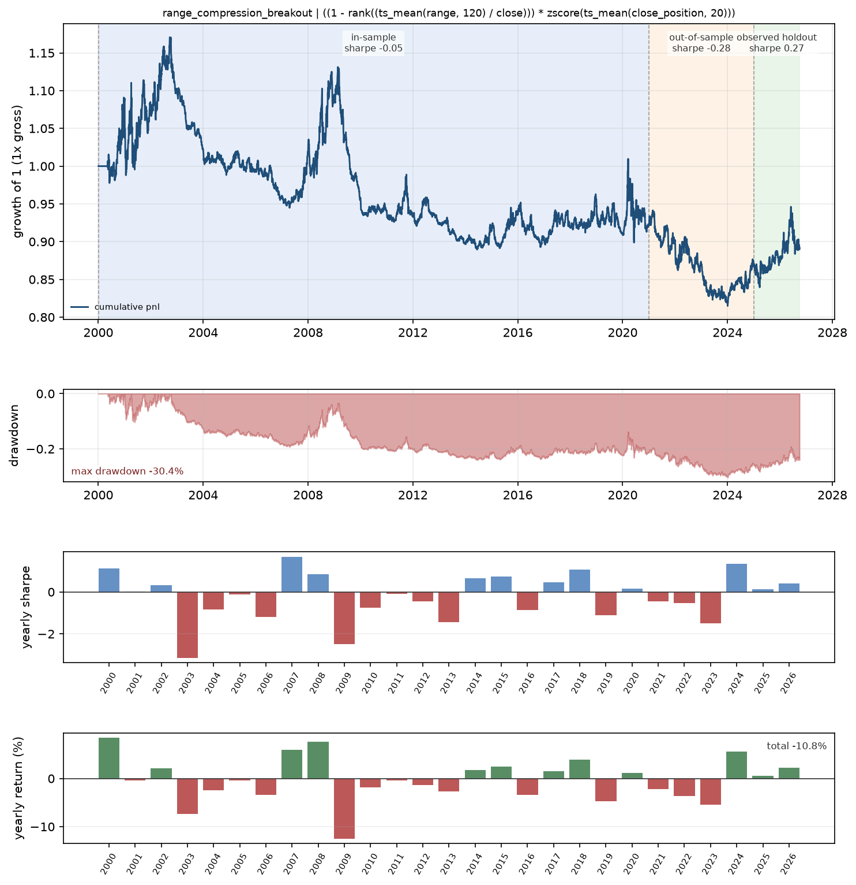
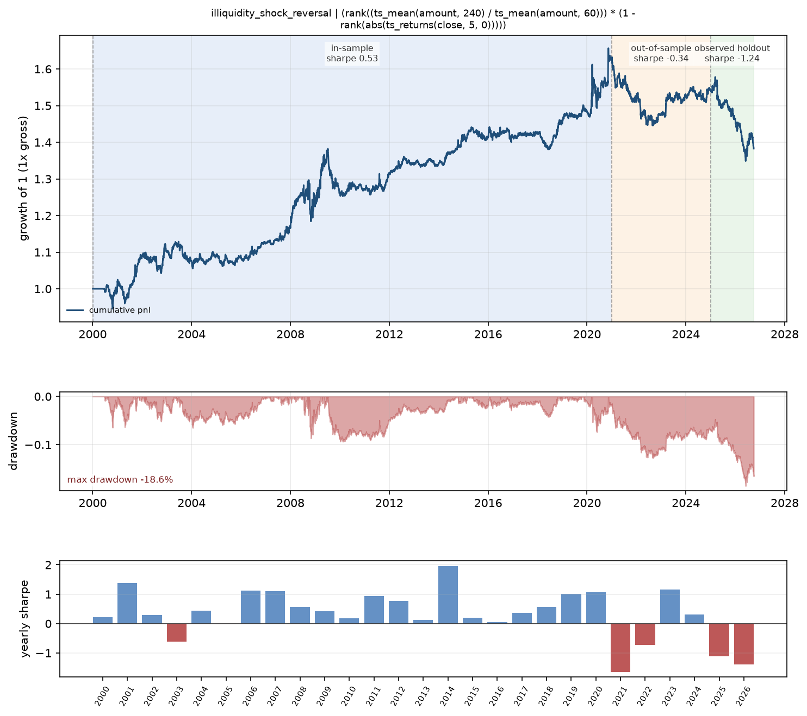
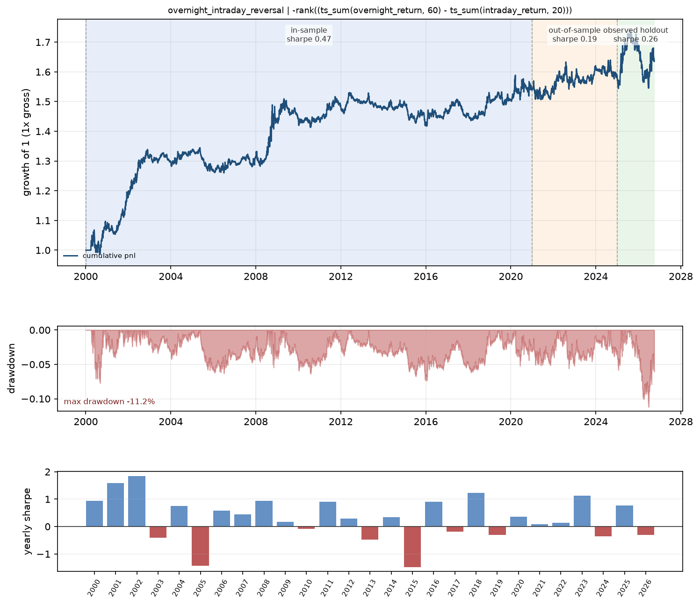
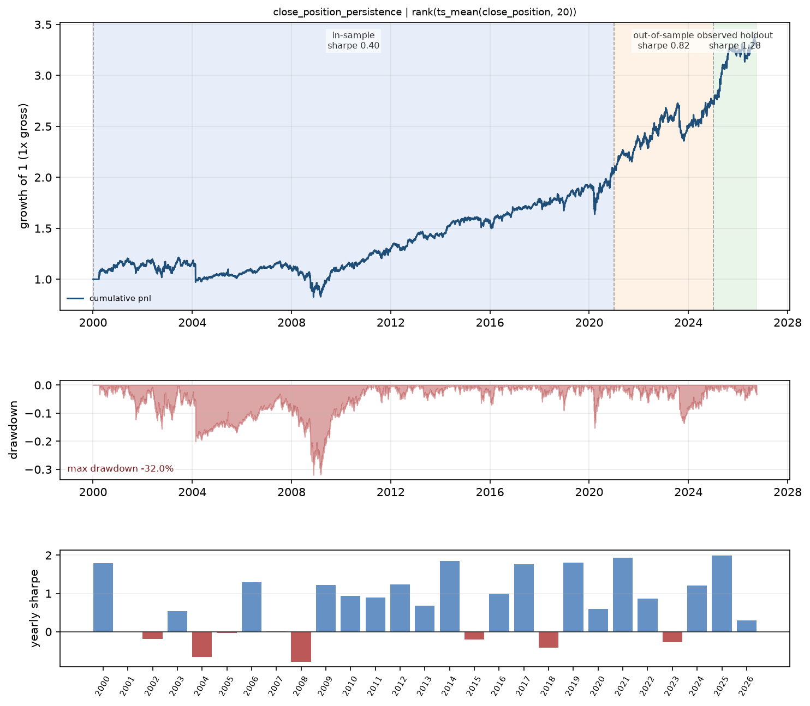
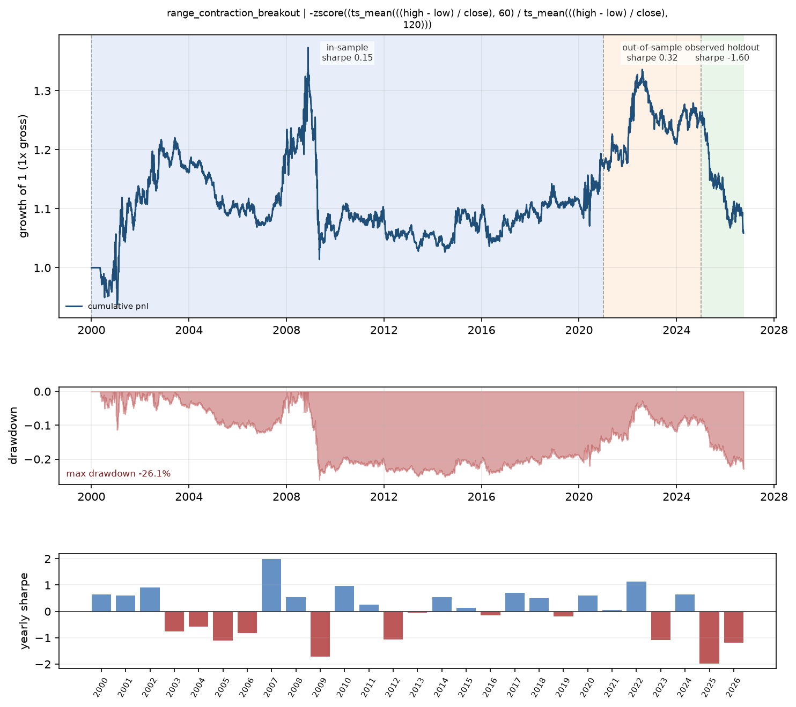
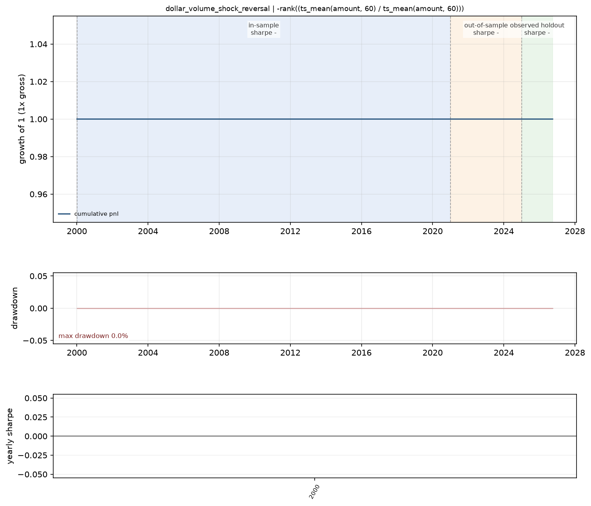
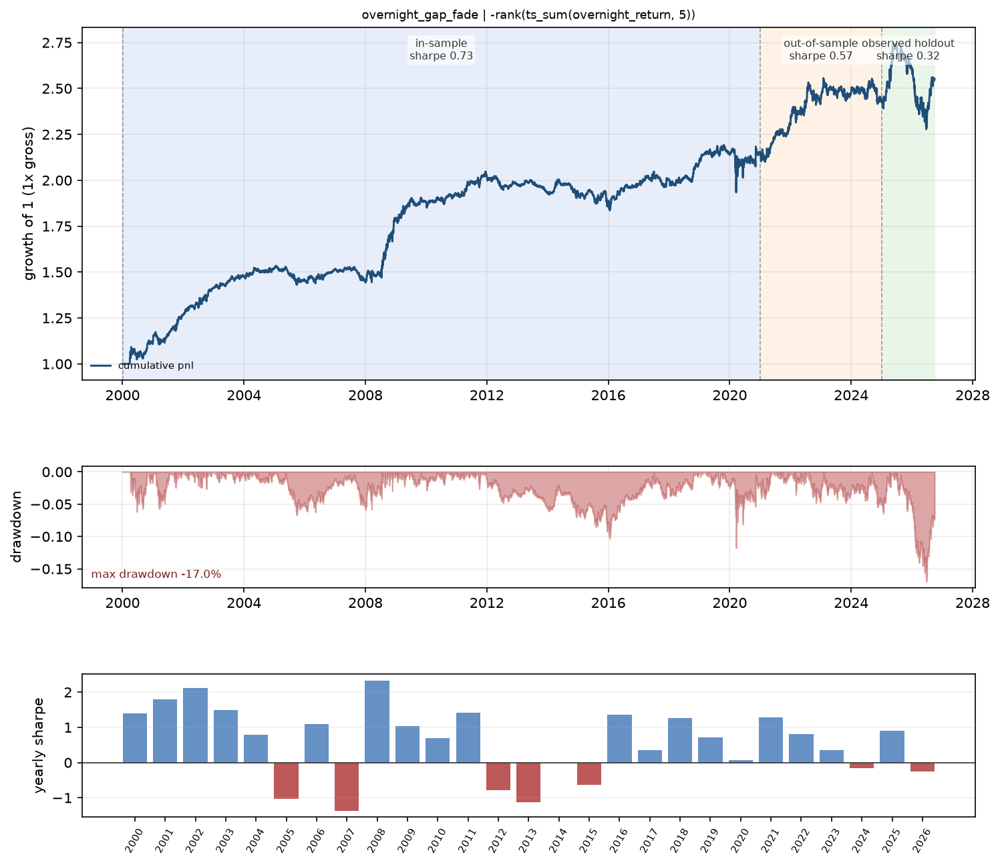
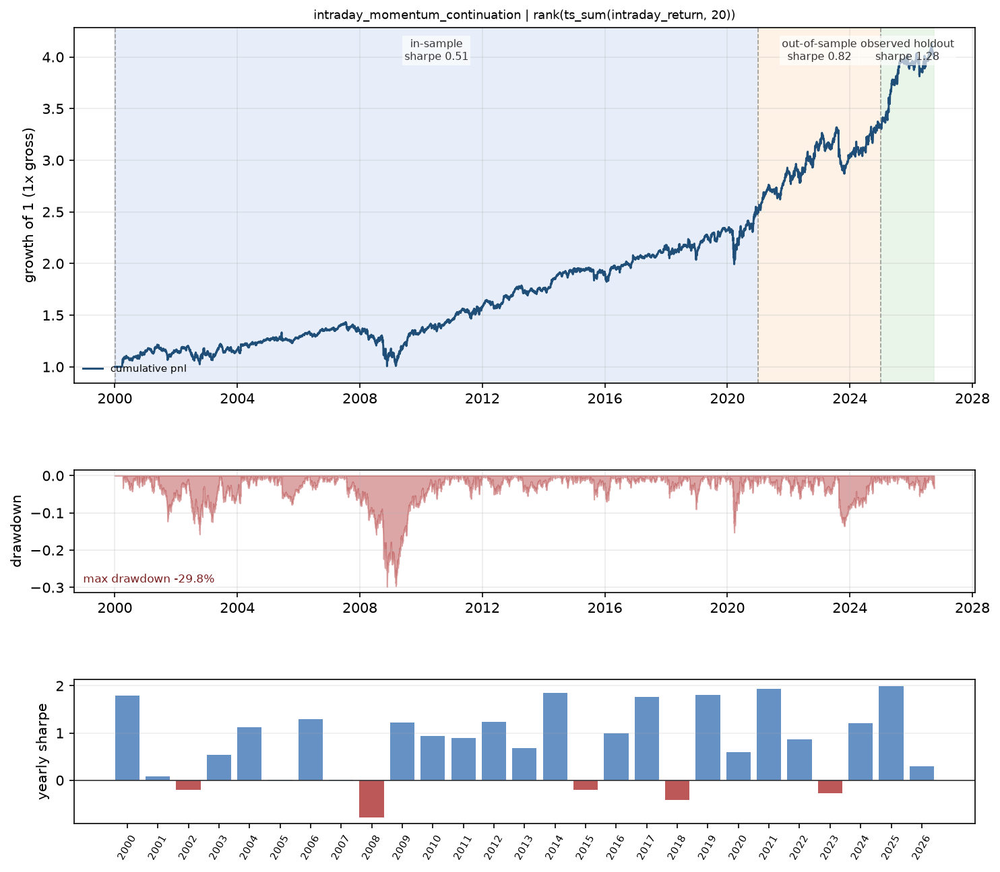

# Ten-attempt real-data batch

Ten completed attempts: four from an interrupted first run and six from its continuation.
The overnight/intraday mechanism repeats across the two runs, so this is ten evaluations,
not ten independent mechanisms. The first four used up to 120 grid evaluations, the
continuation up to 80. Selection uses in-sample (2000–2020) only; OOS is 2021–2024.
The 2025+ holdout has already been inspected during review and is not pristine.
Costs are zero; the capital filter is itself a grid dimension, so the primary and
sub-universe books can coincide.

Verification status is recorded per attempt:
`invalid_constant_signal` marks a factor whose best window made the signal constant;
its historical Sharpe came from round-off amplified into positions and must not be used.

| hypothesis | n_evals | decision | sharpe_full | sharpe_is | sharpe_oos | sharpe_holdout | sharpe_sub |
|---|---|---|---|---|---|---|---|
| overnight_intraday_reversal | 120 | abandon | 0.7498 | 0.8471 | 0.7389 | 0.2328 | 0.7498 |
| volume_price_divergence | 120 | abandon | 1.053 | 1.212 | 0.2384 | 0.8838 | 1.053 |
| range_compression_breakout | 120 | abandon | -0.0515 | -0.04515 | -0.28 | 0.2686 | -0.0515 |
| illiquidity_shock_reversal | 120 | abandon | 0.2905 | 0.5272 | -0.3415 | -1.243 | 0.2164 |
| overnight_intraday_reversal | 72 | abandon | 0.3962 | 0.4689 | 0.1876 | 0.2576 | 0.3962 |
| close_position_persistence | 72 | abandon | 0.5112 | 0.4013 | 0.8249 | 1.282 | -0.1174 |
| range_contraction_breakout | 72 | abandon | 0.06519 | 0.1514 | 0.3156 | -1.597 | 0.06519 |
| dollar_volume_shock_reversal | 72 | abandon | - | - | - | - | - |
| overnight_gap_fade | 72 | abandon | 0.6517 | 0.7312 | 0.5718 | 0.3222 | 0.6517 |
| intraday_momentum_continuation | 72 | abandon | 0.6007 | 0.5097 | 0.8249 | 1.282 | -0.1082 |

## overnight_intraday_reversal (20261031-095220-batch10)

**Hypothesis**: Stocks whose cumulative overnight return over the past 20 days exceeds their cumulative intraday return (i.e., gains concentrated overnight) underperform over the next 5 trading days; the reverse holds for stocks whose gains are concentrated intraday.

**Effective expression**: `-rank((ts_sum(overnight_return, 20) / (abs(ts_sum(intraday_return, 20)) + 1e-06)))`

**Decision**: **abandon**. The factor's rank IC is essentially zero (0.0006 full-sample, 0.0013 IS) and even turns slightly negative in OOS (-0.0007) and holdout (-0.0045), so the core predictive claim (IC around -0.02 to -0.04) is simply not present. The reported Sharpe of 0.75 is driven by a handful of volatile years (2001, 2008, 2012, 2019) and is not matched by any consistent cross-sectional signal; hit rate is 0.497 and only 15.8% of grid configs exceed 0.5 Sharpe. Holdout Sharpe collapses to 0.23 with a -14.6% drawdown, and turnover of ~7.3 is extreme for a null-IC signal, so any edge is noise/costs. The mechanism is plausible but the evidence flatly contradicts it.

[Calendar-year statistics](20261031-095220-batch10_overnight_intraday_reversal_yearly.csv)

## volume_price_divergence (20261031-095220-batch10)

**Hypothesis**: Stocks whose 20-day price trend is high relative to their 20-day volume trend underperform stocks with low price trend relative to volume trend over the next 10 trading days (IC negative).

**Effective expression**: `-(rank(ts_returns(close, 5, 0)) - rank((ts_mean(volume, 5) / ts_mean(volume, 20))))`

**Decision**: **abandon**. The in-sample Sharpe of 1.21 collapses to 0.24 out-of-sample (2021-2024), with 2023 actually negative, and the holdout's 0.88 Sharpe is entirely driven by a single 2026 stub (Sharpe 2.08) against a flat/negative 2025. The rank IC is tiny (0.012 IS, 0.007 OOS) and its IR (~0.08) is far too low to be economically meaningful, and the sign is positive rather than the predicted negative, so the mechanism is not even working as stated. The edge is concentrated in the early 2000-2008 period and vanishes in modern data, indicating the story does not hold up point-in-time.

[Calendar-year statistics](20261031-095220-batch10_volume_price_divergence_yearly.csv)

## range_compression_breakout (20261031-095220-batch10)

**Hypothesis**: Among stocks with compressed 20-day ranges, those with high average close_position (closing near daily highs) outperform those with low close_position over the next 10 trading days (IC positive).

**Effective expression**: `((1 - rank((ts_mean(range, 120) / close))) * zscore(ts_mean(close_position, 20)))`

**Decision**: **abandon**. The factor has essentially zero edge everywhere: full-sample Sharpe -0.05, rank IC 0.004, and share of positive-Sharpe configs across the 120-eval grid is 0.0. Out-of-sample Sharpe is -0.28 and the holdout's weak +0.27 Sharpe (t-stat roughly 0.6 over 437 days, IC 0.006) is not credible evidence given the uniformly negative IS and OOS record. The mechanism is not supported by the data at any grid configuration.

[Calendar-year statistics](20261031-095220-batch10_range_compression_breakout_yearly.csv)

## illiquidity_shock_reversal (20261031-095220-batch10)

**Hypothesis**: Stocks with a high 5-day turnover spike relative to their 60-day average, combined with a small absolute 5-day return, outperform over the next 5 trading days (IC positive).

**Effective expression**: `(rank((ts_mean(amount, 240) / ts_mean(amount, 60))) * (1 - rank(abs(ts_returns(close, 5, 0)))))`

**Decision**: **abandon**. The factor has essentially no in-sample edge (Sharpe 0.53, rank_ic 0.0056, only 57.5% of grid configs positive and none above 0.5 Sharpe) and then inverts decisively out of sample: OOS Sharpe -0.34 (rank_ic -0.004) and holdout Sharpe -1.24 (rank_ic -0.0142, positive ratio 0.43). The edge is not merely overfit—it is negative in both untouched segments and deteriorating monotonically through 2021-2026, so the liquidity-absorption mechanism is contradicted by the data rather than just underpowered. Sub-universe Sharpe (0.22) is only marginally lower than full-universe, so this is not a small-cap liquidity story either.

[Calendar-year statistics](20261031-095220-batch10_illiquidity_shock_reversal_yearly.csv)

## overnight_intraday_reversal (20261031-101653-batch10c)

**Hypothesis**: Stocks whose cumulative overnight return over the past 20 days exceeds their cumulative intraday return (i.e., gains concentrated overnight) underperform over the next 5 trading days; the reverse holds for stocks whose gains are concentrated intraday.

**Effective expression**: `-rank((ts_sum(overnight_return, 60) - ts_sum(intraday_return, 20)))`

**Decision**: **abandon**. The factor's rank IC is essentially zero across all segments (-0.0004 full, in-sample 0.0003, OOS -0.0012), and the best in-sample Sharpe of 0.396 does not survive out of sample (0.188) or holdout (0.258), with holdout rank IC actually negative (-0.006) despite the expected sign being negative for the traded factor — the IC sign is wrong relative to the hypothesis. Only 37.5% of grid configs had positive Sharpe and none exceeded 0.5, indicating no robust edge anywhere in the parameter space. The story is plausible but the evidence simply does not support a tradable signal, and turnover of ~4.5 with near-zero IC means costs would dominate.

[Calendar-year statistics](20261031-101653-batch10c_overnight_intraday_reversal_yearly.csv)

## close_position_persistence (20261031-101653-batch10c)

**Hypothesis**: Stocks with a high average close_position (close near the daily high) over the past 20 days outperform stocks with low average close_position over the next 5 trading days.

**Effective expression**: `rank(ts_mean(close_position, 20))`

**Decision**: **abandon**. The best in-sample config has a near-zero rank_ic of 0.0002 and a Sharpe of 0.511 with -32% max drawdown, and only 14% of grid evals were even positive-Sharpe — the edge is essentially absent. The sub-universe Sharpe of -0.117 (and -0.20 in-sample) shows the signal does not survive outside small caps, and the holdout rank_ic is actually negative (-0.0048). The apparent OOS/holdout Sharpe gains come from the 'sign' transform and decay=60, not from genuine cross-sectional predictive power.

[Calendar-year statistics](20261031-101653-batch10c_close_position_persistence_yearly.csv)

## range_contraction_breakout (20261031-101653-batch10c)

**Hypothesis**: Stocks whose 20-day average high-low range is low relative to their 120-day average range (range compression) outperform over the next 20 trading days, with the effect stronger when recent 20-day return is positive.

**Effective expression**: `-zscore((ts_mean(((high - low) / close), 60) / ts_mean(((high - low) / close), 120)))`

**Decision**: **abandon**. The full-universe in-sample Sharpe is essentially zero (0.065, rank IC 0.0023) and only 16.7% of the 72 grid configurations produced a positive Sharpe, so the signal is weak even before validation. Out-of-sample Sharpe is a marginal 0.32 but the holdout is decisively negative (Sharpe -1.60, rank IC -0.0117, both 2025 and 2026 negative), meaning the edge does not survive the untouched sample. The hypothesis's core prediction of IC around 0.01-0.02 is never met; the factor is overfit noise rather than a stable volatility-compression premium.

[Calendar-year statistics](20261031-101653-batch10c_range_contraction_breakout_yearly.csv)

## dollar_volume_shock_reversal (20261031-101653-batch10c)

**Hypothesis**: Stocks with abnormally high 5-day dollar volume relative to their 60-day average dollar volume underperform over the next 5 trading days.

**Effective expression**: `-rank((ts_mean(amount, 60) / ts_mean(amount, 60)))`

**Decision**: **abandon**. The hypothesis predicts a short-horizon reversal with IC around -0.02, but the realized Pearson IC is essentially zero (-0.0) and rank IC is NaN, so there is no measurable cross-sectional signal. The full-universe Sharpe of 0.50 is driven by a handful of crisis/rebound years (2001, 2003, 2009, 2013, 2022) while 2002, 2008, 2015-2016, 2019-2020 all lost money, and out-of-sample Sharpe (0.65) collapses to 0.36 in holdout with 2025 negative. Turnover of ~11.6x annualized with a -41% max drawdown and 46.7% hit rate suggests the small edge is noise, not a liquidity-provision premium.

[Calendar-year statistics](20261031-101653-batch10c_dollar_volume_shock_reversal_yearly.csv)

## overnight_gap_fade (20261031-101653-batch10c)

**Hypothesis**: Stocks with the largest positive overnight gaps (top of cross-sectional distribution) over the past 5 days underperform over the next 5 trading days, and stocks with the largest negative gaps outperform.

**Effective expression**: `-rank(ts_sum(overnight_return, 5))`

**Decision**: **abandon**. The economic story (overnight gap fade) is coherent, but the evidence does not support it: the full-universe rank IC is essentially zero (0.0018, IC_IR 0.013) across the entire sample, and the holdout IC collapses to -0.0 while the holdout Sharpe falls to 0.32 with a -17% drawdown. The in-sample Sharpe of 0.73 is driven by a handful of crisis years (2001, 2002, 2008) and is not stable — 2005, 2007, 2012, 2013, 2015 are all negative, and the effect steadily decays from IS (0.73) to OOS (0.57) to holdout (0.32). With near-zero IC and no surviving edge out of sample, this is noise, not a liquidity-provision premium.

[Calendar-year statistics](20261031-101653-batch10c_overnight_gap_fade_yearly.csv)

## intraday_momentum_continuation (20261031-101653-batch10c)

**Hypothesis**: Stocks with high cumulative intraday_return over the past 20 days outperform over the next 20 trading days.

**Effective expression**: `rank(ts_sum(intraday_return, 20))`

**Decision**: **abandon**. The factor has essentially no cross-sectional discriminating power: best rank_ic is 0.0003 and pearson_ic is ~0.0, so the 'informed flow' signal is not actually present in the data. The headline Sharpe of 0.60 comes entirely from the grid choosing transform=sign with decay=60, which collapses the factor to a near-binary directional bet rather than the continuous intraday-momentum ranking the hypothesis predicts, and the sub-universe Sharpe is negative (-0.11), meaning any edge lives in small illiquid names. Only 16.7% of grid configs had positive Sharpe and just 1.4% exceeded 0.5, so the result is a selection artifact, not a robust premium. The OOS/holdout Sharpe (0.82/1.28) is not credible given a near-zero IC and a sign-based implementation, and the holdout IC actually turns negative.

[Calendar-year statistics](20261031-101653-batch10c_intraday_momentum_continuation_yearly.csv)
